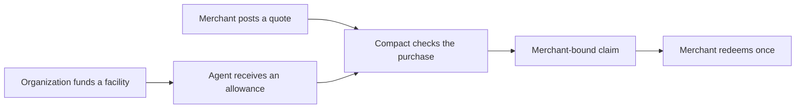

# Line

**Private spending rules. Verifiable checkout.**

Line lets organizations fund autonomous agents, set purchasing allowances and settle merchant claims on Midnight. Compact enforces the spending rules; the connected wallet approves transactions; encrypted browser records retain the private books and pending operations.

[Live application](https://line-midnight.onrender.com/app) · [Product video](https://www.youtube.com/watch?v=rijtpesI6fM) · [Wave progress](docs/PROGRESS.md)

**Network:** Midnight Preprod · **Status:** working prototype

[](https://github.com/ShrikarT/line/actions/workflows/ci.yml)
[](LICENSE)

## What is Line?

An agent should be able to buy a service within its organization's allowance without exposing its plaintext limit and outstanding balance to the public application. A merchant should be able to verify and redeem a claim exactly once.

Line connects these steps through a twelve-circuit Compact contract and separate organization, agent and merchant workspaces. The initial use case is agents buying APIs and compute with organization-owned funds.

## Product

| Capability | Implementation |
| --- | --- |
| Wallet-owned organizations | Compatible Midnight wallets, Preprod checks and wallet-scoped encrypted accounts |
| Spending controls | Private book openings, allowance checks, fees, expiry and issuer-controlled status |
| Merchant checkout | Authenticated quotes, merchant-bound claims and single-use redemption |
| Reserve management | Funding, unencumbered withdrawals and fee withdrawal |
| Recovery | Retained transaction identities, encrypted backups and finalized-receipt reconciliation |
| Multiple merchants | Separate merchant identities and contract-instance domain separation |

**Privacy boundary:** amounts, recipients, reserve changes and transaction history remain observable. Hiding plaintext book fields does not establish full-history balance privacy. See [privacy](docs/PRIVACY.md).

## How it works



The canonical contract records accounting. A separate test-settlement profile has confirmed two-merchant Preprod test-token payouts. The organization-funded profile has completed fresh 1AM funding, allowance opening, quote, draw and a 0.1 tNIGHT redemption to its registered recipient. A subsequent 0.1 tNIGHT replenishment, 0.1 tNIGHT withdrawal, pause/resume and zero-outstanding allowance closure are also verified. Closure retained 0.9 tNIGHT in contract custody. This used the owner's merchant wallet; fee-bearing acceptance and independent merchant fulfillment remain open. These profiles are not interchangeable.

## Midnight contracts

All profiles retain the same twelve circuit names:

| Role | Circuits |
| --- | --- |
| Organization / issuer | `registerMerchant`, `disableMerchant`, `fundReserve`, `withdrawUnencumberedReserve`, `withdrawFees`, `openLine`, `acknowledgeRepayment`, `setStatus` |
| Agent | `draw` |
| Merchant | `postQuote`, `redeemDraw` |
| Expiry / compensation | `cancelOrExpireNote` with its circuit-specific authorization |

Compact is the source of truth. Commitments use Midnight's `persistentCommit` and `persistentHash`; TypeScript encodings are checked against generated execution.

## Wave 1 → Wave 3

| Wave | Delivered / planned |
| --- | --- |
| **Wave 1 — foundation** | Five-circuit spending prototype, compiled Compact, issuer/agent/merchant consoles, reference execution and MCP integration |
| **Wave 2 — checkout** | Twelve circuits, two merchants, reserve controls, redemption, expiry and recovery, confirmed Preprod test-token settlement, wallet-first organization workspace and public app; fresh 1AM organization funding and checkout payout verified |
| **Wave 3 — pilots and hardening** | Independent supplier operation, complete purchasing/recovery acceptance, stronger historical privacy and a real API/compute purchasing pilot |

See [progress](docs/PROGRESS.md) for what is verified and what remains open.

## Getting started

Requires Node.js **22.18+**, npm, `tar` and a Midnight wallet on **Preprod**.

```bash
git clone https://github.com/ShrikarT/line.git
cd line
npm ci
npm run organization:install-release
```

Copy `.env.example` to `.env.local` and set `MIDNIGHT_BLOCKFROST_PROJECT_ID` locally. The example selects wallet-only mode: no hosted signing wallet or supplier seed is needed.

```bash
npm run build:deploy
npm run start:organization
```

Open **http://127.0.0.1:3000/app**, connect your wallet and open your organization. Facility creation, verifier registration and funding each need wallet approval. Optional allowance fees default to zero; the purchase view shows the fee and total allowance charge before approval. Preprod assets have no monetary value.

For UI development, run `npm run dev`. For the complete wallet-only server, use the build/start commands above. The public free host can sleep between visits and does not run automated API suppliers.

## Development

```bash
npm test
npm run typecheck
npx playwright install chromium
npm run test:e2e
```

To regenerate Compact bindings, install the pinned compiler first:

```bash
bash scripts/install-compact.sh
npm run compact:compile
npm run organization:compile
git diff --exit-code contracts/managed/
```

Windows compilation uses WSL. The compiler manager is pinned to Compact **0.31.1**, language **0.23**, runtime **0.16.0** and ledger generation **8**. Installing the published proving release preserves its existing keys; generating a different release is a separate operation.

## Repository

| Directory | Purpose |
| --- | --- |
| `contracts/` | Compact sources, generated bindings and public release metadata |
| `src/` | React workspaces, wallet adapters, encrypted accounts and protocol clients |
| `server/` | Organization API, authenticated Preprod readers and optional supplier runtime |
| `mcp/` | Agent-facing MCP integration |
| `scripts/` | Compiler, proving, runtime and verification tools |
| `tests/`, `e2e/` | Protocol, recovery, transport and browser regressions |
| `docs/` | Architecture, privacy and wave progress |

## Documentation

- [Architecture](docs/ARCHITECTURE.md)
- [Privacy](docs/PRIVACY.md)
- [Wave progress and remaining work](docs/PROGRESS.md)

## License

[Apache-2.0](LICENSE).
