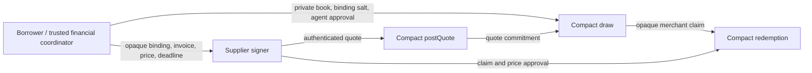

# Private supplier offer experiment — 11 October 2026

The enrollment candidate hides the opening predecessor flag in public queries, but its supplier quote request still contains borrower identity, numeric generation and fee policy. Those requests expose financial information outside the ledger. This separate candidate removes those fields from supplier approval requests while retaining the twelve circuits and exact accounting.

Source: `contracts/experimental/line-private-offer.compact`, SHA-256 `ae970672c048c48692ab690554c77285fec19d1943dc3b4574080970b7fa657d`. Its constructor uses `line:private:offer:domain`. Canonical source, deployed contract and previously verified experimental sources are unchanged.

The borrower or authorized financial coordinator creates a fresh salted Compact commitment to `{domain, identity, generation}`. The supplier receives only that opaque facility binding, invoice, price, nonce and deadline. Its quote uses the exact eight-field `line:offer:quote` persistent hash. The supplier receives neither the binding salt nor the facility's generation, fees or book. Draw recomputes the binding from the authenticated private book and salt, reconstructs the quote, computes the issuer-approved fee and proves `B + A + F <= L`. Agent authorization still covers the exact draw amount and fee. Fee policy stays fixed in the issuer-approved book; the supplier does not set it.

`scripts/private-offer-signers.mjs` is an ephemeral synthetic signer fixture with an explicit supplier field allowlist. Quote requests contain only the four permitted private value fields; redemption approval receives only the claim arguments and principal. The trusted financial prover still supplies the private note metadata needed by Compact. Five direct signer controls reject attempts to send borrower books, fee policy, generation, binding salt or borrower identity to that boundary. This is request minimization, not an authenticated production supplier service or independently administered custody.

The separate durable software signer now has an owner-selected private-offer profile with the exact quote digest, strict payload types and a distinct authenticated storage namespace. Three tests verify signing/restart continuity, cross-profile rejection and denial before local policy. This is cryptographic/profile compatibility; this candidate's full native fixture still uses its original ephemeral children. [Signer scope](DURABLE_APPROVAL_SIGNER_2026-10-11.md).

Fresh generated execution passes **39 normal calls, 26 isolated calls and 72 Compact rejection controls** across all twelve names. Existing enrollment, refund, reserve, expiry, multi-merchant and signature controls remain. New controls reject wrong borrower, domain, generation, binding salt and both fee underpayment and overcharge. Runtime commitments are checked against actual generated Compact state. [Source-bound generated evidence](private-signed-2026-10-11-evidence/offer-feasibility.json).

Two additional continuous histories start at the same reachable funded predecessor. They use one borrower and supplier, the same invoice, principal of 15, nonce, expiry and binding salt, but different private issuer-approved books: `(L=100,F=1)` and `(L=110,F=2)`. Each performs consent, acceptance, quote, draw and redemption. The supplier quote values and quote commitment are exactly equal, while debts are 16 and 17 and remaining capacities are 84 and 93. These histories are isolated from the normal accounting lifecycle.

This finite comparison addresses one exact inference channel **when fee policy is confidential**. If an observer already knows the starting balance, every purchase and every fee, deterministic accounting still reveals debt unless there are other unknown financial transitions. No commitment can hide a fact logically implied by the observer's knowledge. A commitment-looking hex value and one matched request do not prove full transcript distributions, anonymity or complete historical privacy. Fresh per-offer salts and private transport are required; reusing bindings can add linkability. Catalogs, action timing, caller/DUST metadata, proof-provider access, serialized sizes, probing, closure, repayment and asset events remain acceptance work.

Native verification of this exact source is active. [The complete key manifest](private-signed-2026-10-11-evidence/offer-key-generation.json) records newly generated quote and draw pairs (k=16 / 41663 rows and k=18 / 144556 rows), and ten cache hits verified against byte-identical freshly generated IR and the completed enrollment proof report. This is not twelve fresh key generations or inherited native verification of the new source. The generated comparison is not real proof evidence, network execution or authentic settlement. All signers remain synthetic same-host children and financial openings are volatile.

Reproduce generated controls with `npm run offer:spike`. Native verification, once full artifacts and a fresh source-bound fixture are ready, uses `npm run proof:offer -- <full-managed-dir> --compiled-check <fresh-generated-managed-dir> --recycle-prover --recycle-each-call`. The driver requires 39 normal and all 26 isolated native-verified calls, coverage of all twelve names and eight decodable corrupted draw rejections before completion. It uses a synthetic ledger/time with fee balancing disabled, and owns only its labeled loopback prover.
